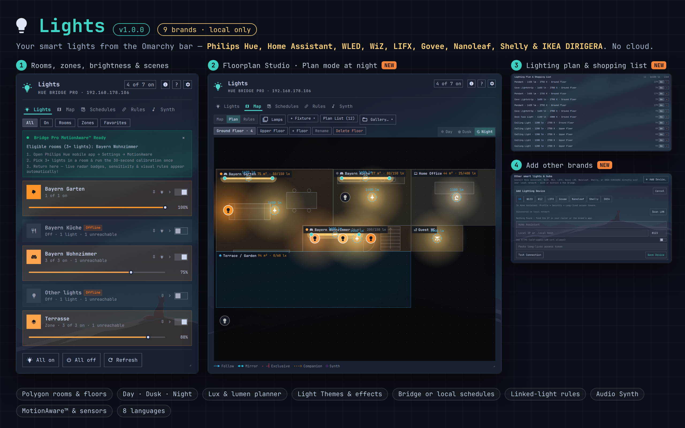

# Lights

Control your smart lights from the Omarchy bar — **Philips Hue**, **Home Assistant**, **WLED**, **WiZ**, **LIFX**, **Govee LAN**, **Nanoleaf**, **Shelly**, and **IKEA DIRIGERA**, side by side, straight over your local network with no cloud account. Design your home in **Floorplan Studio v2** with polygon rooms, several floors, a starter gallery and a Future Lighting Planner, and keep rooms, scenes, colors, effects, Light Themes, schedules, linked-light rules and the audio-reactive Synth in one panel.



## Highlights

- **Multi-brand local lighting:** Philips Hue (CLIP v2 with live events, Bridge Pro MotionAware™, sensors) plus Home Assistant (local REST API, 100+ brands), WLED, WiZ, LIFX, Govee LAN, Nanoleaf, Shelly and IKEA DIRIGERA, with or without a Hue Bridge. **Scan LAN** finds devices, **Add all found** adds every device that needs no token, and each brand shows a short setup hint. Rooms show a brand pill and an orange **Offline** pill when none of their lights answers.
- **Floorplan Studio v2 (`Map` and `Plan` modes):** polygon rooms (rectangle, L-shape, bay window, T-shape, hallway, angled wall; drag a midpoint to add a corner, right-click a corner to remove it), several floors (add, rename, switch, delete with Undo), Day / Dusk / Night simulation, a starter gallery with an optional lighting plan, and a **Future Lighting Planner** for virtual fixtures and LED strips with lumens, Kelvin, beam radius and price, estimated room lux and a shopping list.
- **Safe by default:** deleting a schedule or rule asks for a second click, removing a device asks to confirm, connection errors get a **Retry** button, and a renewed device certificate can be trusted again without losing the saved token.

- **Bar icon:** Choose from 8 Nerd Font glyphs (default bulb, lit in your theme's green while any light is on, dim when all are off) with an optional lit-count badge. Left click opens the panel; right click switches every light off. The tooltip lists your rooms with their brightness.
- **Lights tab:** One card per room and zone with Hue archetype icons, live CLIP v2 Server-Sent Events updates, brightness sliders, filter pills (*All, On, Rooms, Zones, Favorites*), a pinned **Favorites** strip, smart **All On** (with per-room *Exclude from All On* and optional confirmation) and **All Off**. Expand any room for scenes and individual lights, and expand any light for **Kelvin warmth**, **color swatches**, **native Hue effects**, and **Per-Lamp Light Themes** (8 built-in themes + custom themes + *"Save current as theme"*). Unreachable lights are marked clearly.
- **Other smart lights & hubs (⚙):** Add, edit, switch off, test or remove extra light sources. Home Assistant needs a long-lived access token, Nanoleaf and IKEA DIRIGERA are paired with their button, the others are controlled directly on the LAN. A token you type in is sent from the panel to the helper once, with Save or Test; after that it is stored only in `~/.config/omarchy/lights/providers.json` (`0600`) and never sent back to the panel, shown in a snapshot or put in an error message.
- **Map tab (Visual Floorplan & Spatial Light Studio):** Drag and place lamps from a collapsible, searchable **Unplaced / Placed** sidebar onto a pan/zoom 2D home map with live radial color halos. Start instantly from **6 editable house/apartment prototypes** (*Auto from Bridge, Studio / Loft, 1-Bedroom Apartment, 3-Room Apartment, Family House + Terrace, Desk & Gaming Studio*) with draggable, 90°-rotatable architectural furniture stamps (*Door, Window, Sofa, TV, Desk, Bed, Dining, Kitchen*) — or load an optional **custom floorplan background image** (PNG/JPG/WebP, opacity & fit controls). Choose from **12 lamp icons** (*bulb, spot, strip, floor, table, pendant, ceiling, wall, bar, desk, outdoor, candle*), rename lamps inline, surround lamps with **resizable Room & Zone boxes**, recall or save **Room Scenes**, click **⏰ Schedule scene** right from a room box, and draw **typed dependency wires** (Solid Cyan *Follow/Mirror*, Dashed Coral *Exclusive*, Dotted Amber *Companion*, Magenta *Synth* overlay). Push rooms, zones, names, and Entertainment Area 2D/3D positions to your Hue Bridge with **1-click Sync** or optional **Auto-sync**. Floorplan v2 adds polygon rooms, several floors, Day / Dusk / Night simulation, a starter gallery, and the **Plan** mode for planned fixtures and LED strips with estimated lux and a shopping list.
- **Schedules tab:** Create, enable/disable, and delete per-light, per-room, or **room-scene** schedules with weekday recurrence, brightness, and fade duration. Choose in Settings between **On Hue Bridge** (`behavior_instance`, runs 24/7 even when your PC is off, including sunrise/sunset) or **On this PC (live)** (local clock schedules).
- **Rules tab:** Link lights and rooms with **Follow / Mirror**, **Exclusive**, and **Companion** rules (brightness matching, *Only if off*, optional time windows, cycle detection, state-aware echo suppression, pause switch, and recent activity log).
- **Synth tab (Audio-Reactive Light Synthesizer):** Live 3-band Bass / Mids / Treble meters with beat detection driving your lights from **System audio** (`parec @DEFAULT_MONITOR@`), **Microphone** (`parec @DEFAULT_SOURCE@`), or built-in **Demo beat**. Includes 4 modes (*Club, Chill, Ambient, Strobe*), 6 color palettes, target room selector, and sensitivity/smoothness controls. Audio is analyzed strictly in memory and never recorded, written to disk, or sent over the network.
- **Bridge Pro MotionAware™ & Physical Hue Sensors:** Live MotionAware™ presence indicators on rooms and lamps, per-area enable and sensitivity controls, and physical Hue motion, contact, and switch sensors placeable on the Map and usable as Rule triggers.
- **Animated Help & Guide (`?`):** Built-in 9-card visual feature tour with lightweight pure-vector animations (running only while open).
- **Optional Ask AI (off by default):** Opt in under Settings (**Ask AI (Optional)**) to reveal the compact **✦** header button and control lamps, rooms, scenes, rules, and schedules in plain language via the zero-dependency local parser (`scripts/hue-ai.py`), with optional local-only Ollama fallback (`http://127.0.0.1:11434`). When off, no AI UI is shown outside Settings & Help.
- **Local MCP Server for AI Agents:** External AI agents can connect over local stdio (`python3 -I scripts/hue-mcp.py`) to inspect and control lights, scenes, sensors, schedules, and rules while Hue Bridge credentials remain private inside `~/.config/omarchy/lights/config.json`.

## Languages and settings

The interface is built in in eight languages: English, German (Deutsch), French (Français), Spanish (Español), Italian (Italiano), Portuguese (Português), Dutch (Nederlands) and Polish (Polski). It follows the system language (`LC_ALL`, `LC_MESSAGES`, `LANG`) and falls back to English. Open the **gear (⚙)** at the top right of the panel to configure:

- **Language:** Stored in the widget's entry in `~/.config/omarchy/shell.json` (`"language"`); **System (…)** removes it again.
- **Schedule mode:** **On Hue Bridge** (default, runs 24/7 on the bridge) or **On this PC (live)** (runs locally while the widget is loaded).
- **Confirm before All On:** Ask once inline before turning all lights on.
- **App skin:** Choose from 6 visual skins (*System Native, Neon Synthwave, Cozy Cabin, Retro Terminal, Disco Lava, Minimal Zen*) while preserving Omarchy's `PopupGlass` window style.
- **Bar icon & Show lit count:** Pick one of 8 Nerd Font bar glyphs and optionally show the active light count beside the icon.
- **Ask AI (Optional):** Off by default (`"askAi": true` in `shell.json` only when switched on). Enables the compact **✦** Ask AI header button and local natural-language prompt view.
- **Panel size & offset:** Drag the bottom-right resize grip on the panel or adjust Width, Height, and X/Y Offset in Settings (with one-click Reset); saved in `~/.config/omarchy/shell.json`.
- **Corners:** *Like windows (… px)* (default, follows Hyprland's `decoration:rounding`), *Slightly rounded (6 px)*, *Rounded (12 px)*, or *Square*. Stored as `"corners"` in `shell.json`.
- **F12 saves a screenshot** (on by default; stored as `"screenshotKey": false` when switched off, see below).
- **Bridge & Unpair:** Shows the paired bridge and confirm-twice **Unpair**.

The settings page closes with **← Back**, Backspace, or Esc.

### F12: a screenshot of the panel, with a note

While the panel is open, **F12** (without Ctrl, Shift, Alt or Super) saves a picture of the panel, for telling what is wrong with it:

- **Only on F12.** Nothing is captured at any other time, and only the panel itself (`grabToImage`). No screen capture tool runs, nothing else on the screen is in it, and nothing is uploaded or sent anywhere.
- **Where:** `~/Pictures/Lights/lights-<date>-<time>.png` (or the pictures folder from `~/.config/user-dirs.dirs`). An optional note (up to 4000 characters) can be saved next to it as `.txt`.
- **Private files:** Folder `0700` (verified real directory owned by you), new `0600` files created atomically via `shot_save.py` (fixed argv, never a shell) from `$XDG_RUNTIME_DIR/ubruckhaus.lights-shot/`.
- **Off:** Switch **F12 saves a screenshot** off on the settings page.

The **ⓘ** button beside the gear opens an **Information** page showing the author's other Omarchy plugins (loaded at most once an hour from the marketplace catalog via `plugin_catalog.py` using `curl --proto =https --max-redirs 0`, cached in `~/.cache/ubruckhaus.lights/plugin-catalog.json` mode `0600`).

## Install

Requires Omarchy's plugin-capable Quickshell, `python3` (standard library only, no extra packages), and `avahi-browse` (Avahi, installed on Omarchy) for bridge and device discovery. Optional: `parec` (PipeWire/PulseAudio, installed on Omarchy) for the Audio Light Synthesizer's System Audio / Microphone modes (Demo Beat works with zero audio tools). No setup script is needed, and the plugin never asks for root or administrator rights.

```sh
omarchy plugin add https://github.com/uBruckhaus/omarchy-lights
omarchy plugin enable ubruckhaus.lights
```

### Coming from Hue Lights

Lights is the successor of the Hue Lights plugin (`ubruckhaus.hue-lights`). On its first start, when `~/.config/omarchy/lights/` does not exist yet, it imports the bridge pairing, floorplan, themes, rules and local schedules from `~/.config/omarchy/hue-lights/` once. The old files are only read (through the same checks as its own files: regular files you own, no links, size limits) and never changed; files from other plugins in that folder are ignored. A floorplan background image is not carried over; add it again on the Map tab. Remove the old widget from the bar so only one of them talks to the bridge.

## Pairing

1. Open the panel. Hue bridges on your network are found automatically via mDNS, or enter the bridge IP by hand.
2. Click **Pair**, then press the round link button on top of the bridge within 30 seconds.

If the bridge later gets a new IP address, the plugin finds it again by its bridge ID.

## How it works

A helper (`scripts/hue-lights.py`) runs while the widget is loaded. The bar widget sends JSON commands over stdin; the helper streams JSON snapshots on stdout over live CLIP v2 SSE (`/eventstream/clip/v2`) with bounded REST fallback (every 2 s while the panel is open, every 20 s while closed).

- **Local only:** Bridge traffic goes strictly to the bridge's local CLIP v2 API over HTTPS on your LAN. Extra devices (`scripts/hue_providers.py`) are reached only on private LAN addresses (Home Assistant also on loopback): HTTP for WLED, Shelly, Nanoleaf and Home Assistant (HTTPS optional, pinned on first use), UDP for WiZ (38899), LIFX (56700) and Govee (4003), HTTPS with a pinned certificate for IKEA DIRIGERA. `.local` names are resolved once and the checked address is used for the connection. **Scan LAN** uses `avahi-browse` and UDP broadcasts for WiZ, LIFX and Govee, only when you click it or open the device editor. The Information page's plugin list (`plugin_catalog.py`) is the only outbound internet request and only runs when you open **ⓘ**.
- **Pinned certificate:** During pairing, the helper checks that the bridge certificate's CN matches the bridge ID and pins its SHA-256 fingerprint. Every subsequent HTTPS and SSE connection verifies the exact pin.
- **Bounded requests & subprocesses:** Every HTTP request and SSE handshake has one overall deadline (connect, TLS, headers, and body/line timeout) and a 4 MiB cap. `avahi-browse` runs with a fixed argv list, bounded output, and timeout. When the user explicitly clicks **Start** in the **Synth** tab with System Audio or Microphone selected, `SynthController` starts `parec` (`shutil.which("parec")`, fixed argv `--raw --format=s16le --channels=1 --rate=16000 --device=@DEFAULT_MONITOR@` or `@DEFAULT_SOURCE@`, `shell=False`, `stdin=DEVNULL`, `stderr=DEVNULL`); audio samples are analyzed in memory in bounded 512-sample chunks and never saved or transmitted. When `setpriv` is installed, child processes run under `setpriv --pdeathsig KILL --` and are tracked and terminated on Stop, Unpair, SIGTERM, or exit.
- **Validated commands & sanitized text:** Light, group, scene, schedule, rule, and theme IDs are strictly validated; bridge IPs must be private IPv4 addresses; all names are stripped of `<`, `>`, `&`, and control characters; every data-bearing QML `Text` uses `textFormat: Text.PlainText`, and every text input uses the hardened `KeyTextField`.
- **Private local state (`0700` dir / `0600` atomic files):** Stored under `~/.config/omarchy/lights/`: `config.json` (bridge pairing & app key, which never leaves the helper), `floorplan.json` (layout, rooms, stamps, lamp icons, and optional validated copy `floorplan_bg.<ext>`), `providers.json` (extra devices and their tokens, opened with `O_NOFOLLOW` and owner/mode checks), `themes.json`, `rules.json`, `local_schedules.json`, and `.local_schedules.lock` (`O_NOFOLLOW` cross-process schedule lock).

## Update or remove

```sh
omarchy plugin update ubruckhaus.lights
```

```sh
omarchy plugin disable ubruckhaus.lights
omarchy plugin remove ubruckhaus.lights
```

The plugin creates no services. Outside its folder it stores `~/.config/omarchy/lights/` (bridge pairing, extra devices, themes, rules, local schedules) and `~/.cache/ubruckhaus.lights/` (Information page cache); F12 screenshots stay in `~/Pictures/Lights/`. **Unpair** (gear ⚙ → Bridge) deletes `config.json` (or remove `~/.config/omarchy/lights/` entirely). To revoke the key on the bridge as well, remove `omarchy_hue_lights` in the Hue app under *Settings → Apps*.

## Development

```sh
python3 -m unittest discover -s tests
```

`PanelShot.qml`, `shot_save.py`, `corners.js`, `KeyTextField.qml`, `CompactDropdown.qml`, `MorePlugins.qml`, `PopupGlass.qml`, and the shared texts in `I18n.js` come from the author's shared plugin kit.

## License

MIT
